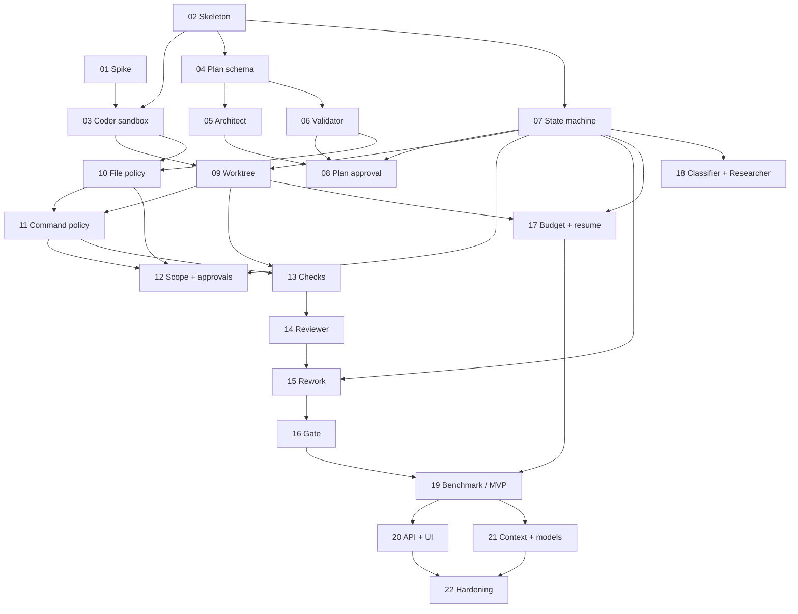

# Implementation Plan — Chia theo bước

Tài liệu gốc: [`../multi-agent-software-engineering-master-plan.md`](../multi-agent-software-engineering-master-plan.md) (v2).
Mỗi file dưới đây là **một bước** trong §45 của master plan, có checklist, output và tiêu chí hoàn thành.

## Cách dùng

1. Chỉ bắt đầu một bước khi tất cả bước trong **Phụ thuộc** đã đạt tiêu chí hoàn thành.
2. Làm theo checklist **Việc cần làm**; tick `[x]` khi xong.
3. Bước chỉ được coi là xong khi **mọi** mục trong **Tiêu chí hoàn thành** đạt, có bằng chứng (test, log, event).
4. Cập nhật cột **Trạng thái** trong bảng dưới và dòng `Trạng thái` ở đầu file bước.
5. Quyết định kiến trúc phát sinh → ghi ADR vào `docs/decisions/ADR-XXX-*.md`.

Trạng thái: `☐ Chưa làm` · `◐ Đang làm` · `☑ Xong` · `✖ Bỏ / thay thế`

## Danh sách bước

| # | Bước | Phase | Phụ thuộc | Trạng thái |
|---|---|---|---|---|
| 01 | [Spike OpenHands + Docker trên Windows](phase-1-foundation/01-spike-openhands-docker.md) | 1 | — | ☐ |
| 02 | [Skeleton, event log, Golden Tasks (10)](phase-1-foundation/02-skeleton-eventlog-golden-tasks.md) | 1 | — | ☐ |
| 03 | [Coder chạy trong sandbox](phase-1-foundation/03-coder-in-sandbox.md) | 1 | 01, 02 | ☐ |
| 04 | [Plan schema v2 + render plan.md](phase-2-planning-state/04-plan-schema.md) | 2 | 02 | ☐ |
| 05 | [Architect](phase-2-planning-state/05-architect.md) | 2 | 04 | ☐ |
| 06 | [Plan Validator](phase-2-planning-state/06-plan-validator.md) | 2 | 04 | ☐ |
| 07 | [State machine + SQLite](phase-2-planning-state/07-state-machine-persistence.md) | 2 | 02 | ☐ |
| 08 | [Plan approval (CLI)](phase-2-planning-state/08-plan-approval-cli.md) | 2 | 05, 06, 07 | ☐ |
| 09 | [Git worktree + checkpoint + revert](phase-3-safety/09-git-worktree-checkpoint.md) | 3 | 03, 07 | ☐ |
| 10 | [File Policy (read + write)](phase-3-safety/10-file-policy.md) | 3 | 03, 06 | ☐ |
| 11 | [Command Policy + post-exec diff check](phase-3-safety/11-command-policy-post-exec.md) | 3 | 09, 10 | ☐ |
| 12 | [Scope request + approvals](phase-3-safety/12-scope-request-approvals.md) | 3 | 07, 10, 11 | ☐ |
| 13 | [Baseline + auto checks + test weakening](phase-4-check-review/13-baseline-checks.md) | 4 | 09, 11 | ☐ |
| 14 | [Reviewer](phase-4-check-review/14-reviewer.md) | 4 | 13 | ☐ |
| 15 | [Rework loop](phase-4-check-review/15-rework-loop.md) | 4 | 07, 14 | ☐ |
| 16 | [Gate + Final report](phase-4-check-review/16-gate.md) | 4 | 15 | ☐ |
| 17 | [Budget + Resume](phase-5-reliability/17-budget-resume.md) | 5 | 07, 09 | ☐ |
| 18 | [Classifier + Researcher](phase-5-reliability/18-classifier-researcher.md) | 5 | 07 | ☐ |
| 19 | [Golden Tasks (25) + benchmark → MVP CLI](phase-5-reliability/19-golden-tasks-benchmark.md) | 5 | 16, 17 | ☐ |
| 20 | [API + UI](phase-6-api-ui/20-api-ui.md) | 6 | 19 | ☐ |
| 21 | [Context optimization + multi-model](phase-7-context-models/21-context-multimodel.md) | 7 | 19 | ☐ |
| 22 | [Hardening + release](phase-8-hardening/22-hardening.md) | 8 | 20, 21 | ☐ |

## Đồ thị phụ thuộc

Có thể làm song song: `01 ∥ 02`, `04 ∥ 07`, `05 ∥ 06`, `09 ∥ 10`, `17 ∥ 18` (cùng lúc với 13–16), `20 ∥ 21`.

## Milestones

| Mốc | Sau bước | Điều kiện | Nếu không đạt |
|---|---|---|---|
| **M1 — Go/No-go runtime** | 01 | G1–G5 trong §2.1 đạt, có ADR-001 | Chuyển sang agent loop tự viết (kiểu mini-SWE-agent), cập nhật bước 03 |
| **M2 — Safety** | 12 | Toàn bộ policy tests §37 pass; GT scope-violation và dangerous-command bị chặn | **Dừng**, không làm phase 4 trở đi |
| **M3 — MVP CLI** | 19 | DoD §39 (trừ UI) đạt; có benchmark report đầu tiên | Không làm UI, quay lại sửa core |
| **M4 — UI** | 20 | Task Detail + Approvals chạy realtime | — |
| **M5 — Release** | 22 | Hardening checklist + docs + installer | — |

## Phương án 5 tuần (§41)

Làm: 01–17, 19 (tối thiểu 10 golden tasks). Bỏ: 18, phần LLM Gate trong 16, 21. Bước 20 chỉ làm trang web read-only (events + diff).
